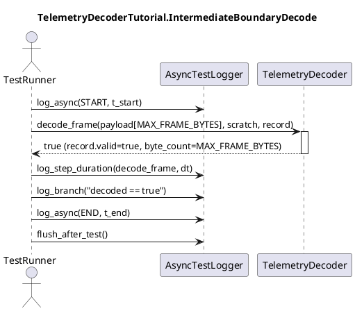

# Constraint 0100

## Title
Comprehensive Testing, Determinism, Logging & Test Documentation Standards

## Description

This constraint applies to all unit, integration, stress, fuzz, concurrency, and tutorial tests written for first-party code within the Quasar ecosystem (all modules under `cmake-projects/`, `linux-modules/`, and `maven-projects/`, excluding third-party test suites under `cmake-projects/third-party` and `ext-projects`). It expands upon the testing mandates introduced in [CS-0030.6 - CS-0030.8](CS-0030.md), [CS-0050.1](CS-0050.md), [CS-0060.7](CS-0060.md), and [CS-0090.2](CS-0090.md) to enforce exhaustive functional coverage, deterministic behavior, non-blocking operational observability, cross-component integration, and formal test documentation.

Regarding this constraint, the following rules apply:

### 1. Coverage, Traceability & Value-Space Completeness
- **[CS-0100.1] Universal First-Party Method Coverage**: Every method, constructor, destructor, operator, and free function included in first-party Quasar code (explicitly excluding third-party code in `cmake-projects/third-party/` and `ext-projects/`) SHALL be covered by automated tests.
- **[CS-0100.2] Mandatory Specification & Task Traceability**: Every test suite and test case MUST be explicitly linked to at least one originating specification, feature request (`@feature` / `FE-*`), task (`@task` / `TSK-*`), requirement (`@requirement` / `REQ-*`), constraint (`@constraint` / `CS-*`), or rule (`@rule`), **except `CS-0100` itself**. Citing `CS-0100` alone is invalid traceability; each test MUST trace to the functional specification, task, or technical constraint whose behavior it verifies (reinforcing [CS-0090.2](CS-0090.md)).
- **[CS-0100.3] Control-Structure & Algorithmic Branch Analysis**: All cases and algorithmic branches inside a tested method SHOULD be exercised by tests. Test authors MUST perform an explicit analysis of the target method's control structures (`if`, `else if`, `else`, `switch`, `case`, `default`, loops, early returns, and `try`/`catch` blocks) to ensure all major operational paths, error paths, and edge cases are tested.
- **[CS-0100.4] Exhaustive Small-Domain & Enumeration Coverage**: Whenever method parameters accept a reduced or finite domain of possible values (such as `enum`, `enum class`, `bool`, bounded bitflags, or discrete state selectors), tests SHALL strive to exercise **all possible valid values** as well as invalid or out-of-range sentinel representations where cast/boundary handling exists.
- **[CS-0100.5] Template & Polymorphic Instantiation Coverage**: Where classes or functions use C++ templates or runtime polymorphism, tests MUST cover at least the **20 most common** instantiations, type combinations, or concrete derived implementations (when 20 or more combinations exist), and SHOULD strive to cover **all** supported template instantiations and polymorphic subclasses (e.g., via GoogleTest `TYPED_TEST_SUITE` or `INSTANTIATE_TEST_SUITE_P`).
- **[CS-0100.6] Design-by-Contract Boundary Testing**: Whenever pre-conditions (`@pre` / `[[expects: ...]]`) or post-conditions (`@post` / `[[ensures: ...]]`) are specified ([CS-0050.1](CS-0050.md), [CS-0090.9](CS-0090.md)), tests SHALL exercise the target code at the exact boundaries of valid inputs (minimum, maximum, empty, capacity limit, and adjacent invalid inputs `min - 1`, `max + 1`) and verify that all post-conditions and output invariants hold on both valid and faulted paths.

### 2. Concurrency, Timing, Exception & Fuzzing Robustness
- **[CS-0100.7] Concurrent Access, Lifecycle & Synchronization Testing**: Every method designed for concurrent execution, or operating on data accessed concurrently across threads, SHALL be covered by dedicated concurrency tests verifying:
  1. **Concurrent Access, Creation & Destruction**: Parallel read/write contention, concurrent object construction, shared ownership transitions (`std::shared_ptr`/`std::weak_ptr`), and safe destruction while references or tasks are active.
  2. **Locks & Mutexes**: Contended acquisition, timed-lock expiration (`std::timed_mutex` per [CS-0010.26](CS-0010.md), [CS-0010.46](CS-0010.md)), lock-order consistency, and absence of data races.
- **[CS-0100.8] Time-Constrained Execution Bounds**: All time-constrained methods (periodic loops, timed waits, watchdogs, protocol handshakes, bounded retries) SHALL be tested with enforced execution duration limits. When no explicit duration is specified by the requirement, a documented symbolic arbitrary upper-bound constant ([CS-0040.2](CS-0040.md)) MUST be enforced in the test.
- **[CS-0100.9] Exhaustive Exception Source Coverage**: Any code implementing exception control (`try`/`catch`), throwing exceptions, or exposed to throwing callees ([CS-0010.20](CS-0010.md)) SHALL be tested against **all possible exception sources** (contract/validation faults, timeout failures, injected dependency errors, I/O or allocator exceptions), verifying exception propagation, rollback, and containment ([CS-0090.8](CS-0090.md)).
- **[CS-0100.10] Parameter Fuzzing in Common Tests**: Common unit and component tests SHOULD include parameter fuzzing (structured and randomized mutation of numeric values, strings, raw byte buffers, and malformed protocol payloads) to expose parsing flaws, overflows, and unhandled edge states.

### 3. Stress Testing, Determinism & Resource Budgets
- **[CS-0100.11] Mandatory Dedicated Stress Tests**: Dedicated stress tests MUST be provided alongside strictly functional tests ([CS-0030.7](CS-0030.md)), explicitly covering:
  1. **Memory Stressing**: Large buffers, long strings, high-cardinality object trees, and repeated allocation/deallocation churn.
  2. **Concurrency Stressing**: High-thread-count contention bursts and rapid parallel creation/destruction cycles.
  3. **Deadlock Verification**: Adversarial lock-ordering, nested mutex contention, and timed-lock timeout recovery verified under ThreadSanitizer or Helgrind.
  4. **Duration Stressing**: Sustained or high-iteration execution runs on time-constrained code to detect drift, resource exhaustion, or latency degradation.
- **[CS-0100.12] Determinism & Reproducible Randomization**: All tests MUST be designed as **deterministic**. Whenever randomization is required for inputs (such as parameter fuzzing per [CS-0100.10] or randomized thread scheduling), the PRNG (`<random>` per [CS-0060.7](CS-0060.md)) MUST use a fixed or explicitly logged deterministic seed, and assertions MUST evaluate deterministic outcomes or invariants so that test results remain strictly reproducible.
- **[CS-0100.13] Deterministic Test Execution Duration**: All tests SHALL be designed to complete within the most deterministic possible amount of time by enforcing bounded loop iterations ([CS-0010.37](CS-0010.md)), explicit timeout guards, and avoiding unbounded sleeps ([CS-0010.27](CS-0010.md)).
- **[CS-0100.14] Resource Budgets & On-Demand Heavy Tests**: Individual tests SHOULD NOT consume more than **2 GB of RAM** and more than **3 minutes (180 seconds) of CPU time**. If a test cannot satisfy this constraint (e.g., extreme memory stress or multi-minute endurance runs), it MAY be marked as `optional` (e.g., via CTest `LABELS "optional;on_demand"`) and executed strictly **on demand** outside standard automated test passes.
- **[CS-0100.15] Cross-Test Compatibility & Isolation**: All tests SHALL be compatible with all other tests in the project so that the entire test suite can pass together cleanly (including under parallel CTest execution). Tests MUST isolate temporary files, network ports, IPC endpoints, and shared registries so no test interferes with another.

### 4. Integration Testing, Component Graph & Pedagogical Tutorials
- **[CS-0100.16] Cross-Module & Architectural Integration Tests**: Whenever tested code interacts with other internal Quasar projects, classes, or functional architectures (for example, Lua scripting interacting with `quasar::named` object hierarchies, or `datacodec` interacting with `resoem`), dedicated integration tests SHALL be added.
- **[CS-0100.17] Dedicated Integration Test Executables**: Additional standalone CMake executable targets MAY be designed and created specifically to host multi-module integration tests, protocol harnesses, or end-to-end simulation suites.
- **[CS-0100.18] Dependency Graph Inference & Third-Party Interfacing**: When designing tests for a module, a dependency graph of all related internal libraries, components, and functional subsets SHALL be inferred so that:
  1. **Direct Third-Party Interface Testing**: Tested code SHOULD be tested through its direct interface with every interfaced third-party library or third-party functional subset (e.g., LuaJIT, Open62541/OPC-UA, ZeroMQ, YAML/Protobuf).
  2. **Simultaneous Multi-Subset Integration**: Tested code SHOULD be tested simultaneously with **multiple** third-party libraries or functional subsets active together (for example, an SMP simulation model integrated simultaneously with Lua scripting and OPC-UA).
- **[CS-0100.19] Pedagogical Tutorial Tests for Public APIs**: Every public API class and every public method SHALL have at least **3 tests** written so they are directly usable as tutorials for human developers, featuring:
  1. **High Readability & Pedagogical Comments**: Clean, self-contained structure with explanatory comments teaching intent, prerequisites, and idioms.
  2. **Progressive Complexity**: At least three distinct cases progressing from the simplest minimal usage, through an intermediate real-world scenario, to the most complete or advanced composition.

### 5. Verbose Asynchronous Logging & Test Documentation
- **[CS-0100.20] Verbose Operational Test Logging**: Tests SHALL log operations verbosely so failures and execution traces can be audited without re-running under a debugger:
  1. **Inputs & Outputs**: All input parameters, configuration settings, and observed output/return values SHALL be logged.
  2. **Timestamps & Step Durations**: Test start and end timestamps SHALL be logged, along with measured execution durations of significant operational steps.
  3. **Control-Structure Branch Tracing**: Every executed case within the test's own control structures (`if`/`else`, `switch`/`case`, `try`/`catch`) SHALL be logged in order to trace executed branches.
  4. **Loop Spam Throttling**: Inside high-iteration loops, logging verbosity MAY be reduced (e.g., logging initial/final iterations, periodic checkpoints, branch transitions, and summary totals) to avoid flooding logs.
- **[CS-0100.21] Asynchronous Non-Blocking Test Logging**: Operational test logs MUST NOT degrade test quality, perturb race conditions, or slow down time-constrained tests. Logging SHOULD be **asynchronous and non-blocking** (matching production operational logging via a bounded lock-free or background-flushed queue outside the critical timing path).
- **[CS-0100.22] Dedicated Test Documentation & PlantUML Diagrams**: All tests SHALL be documented in the project's documentation tree (`doc/docs/`):
  1. **Per-Test-Case Markdown Page**: Each test case SHALL have its own dedicated Markdown documentation page integrated into `doc/mkdocs.yml`.
  2. **PlantUML Behavioral Diagrams**: Test execution sequences, thread/subsystem interactions, and decision flows SHALL be described using **PlantUML sequence diagrams or activity diagrams**.

---

## Standard Compliant Example

### C++ Test Structure (`CS-0100.2`, `CS-0100.6`, `CS-0100.12`, `CS-0100.19`, `CS-0100.20`, `CS-0100.21`)

```cpp
/**
 * @brief Tutorial Case 2 (Intermediate): Decode valid telemetry frame and verify boundaries.
 *
 * @details Demonstrates normal and boundary-limit decoding using deterministic
 * seeded inputs and asynchronous non-blocking operational test logging.
 *
 * @task TSK-20261113-003
 * @requirement REQ-00010
 * @constraint CS-0010.34, CS-0010.37, CS-0060.7, CS-0090.2, CS-0100.2, CS-0100.6, CS-0100.12, CS-0100.19, CS-0100.20, CS-0100.21
 * @feature FE-0010
 * @compliance Uses explicit types (no auto), fixed seed for deterministic PRNG,
 * boundary input testing, and non-blocking async test logging.
 */
TEST(TelemetryDecoderTutorial, IntermediateBoundaryDecode) {
  // Record deterministic test start timestamp via async non-blocking logger [CS-0100.20, CS-0100.21].
  const std::chrono::steady_clock::time_point t_start = std::chrono::steady_clock::now();
  AsyncTestLogger::instance().log_async("START", "IntermediateBoundaryDecode", t_start);

  // Use a fixed seed with <random> to guarantee deterministic fuzz/boundary inputs [CS-0060.7, CS-0100.12].
  constexpr std::uint32_t DETERMINISTIC_SEED = 0x51A5A100U;
  std::mt19937 rng{DETERMINISTIC_SEED};
  AsyncTestLogger::instance().log_kv("seed", DETERMINISTIC_SEED);

  // Construct exact maximum valid buffer boundary per @pre frame_bytes.size() <= MAX_FRAME_BYTES [CS-0100.6].
  std::vector<std::byte> payload(MAX_FRAME_BYTES);
  constexpr std::size_t MAX_INIT_STEPS = MAX_FRAME_BYTES;
  // Bounded initialization loop with reduced logging verbosity to avoid spam [CS-0010.37, CS-0100.20].
  for (std::size_t idx = 0U; idx < payload.size(); ++idx) {
    if (idx >= MAX_INIT_STEPS) {
      throw std::runtime_error{"Exceeded MAX_INIT_STEPS"};
    } else {
      // Populate deterministic byte value from fixed-seed generator.
      payload.at(idx) = static_cast<std::byte>(rng() & 0xFFU);
    }
  }

  TelemetryDecoder decoder{};
  std::vector<std::byte> scratch{};
  TelemetryRecord record{};
  const std::chrono::steady_clock::time_point step_start = std::chrono::steady_clock::now();
  const bool decoded = decoder.decode_frame(payload, std::move(scratch), record);
  const std::chrono::steady_clock::time_point step_end = std::chrono::steady_clock::now();
  AsyncTestLogger::instance().log_step_duration("decode_frame", step_start, step_end);

  // Log branch taken in test control structure so execution path is traceable [CS-0100.20].
  if (decoded == true) {
    AsyncTestLogger::instance().log_branch("decoded == true");
    EXPECT_TRUE(record.valid);
    EXPECT_EQ(record.byte_count, MAX_FRAME_BYTES);
  } else {
    AsyncTestLogger::instance().log_branch("decoded == false");
    FAIL() << "Expected boundary frame decode to succeed deterministically";
  }

  // Record end timestamp and flush async test log buffer outside timed assertion path [CS-0100.21].
  const std::chrono::steady_clock::time_point t_end = std::chrono::steady_clock::now();
  AsyncTestLogger::instance().log_async("END", "IntermediateBoundaryDecode", t_end);
  AsyncTestLogger::instance().flush_after_test();
}
```

### PlantUML Sequence Diagram in Test Documentation (`CS-0100.22`)



## Rationale

Industrial automation middleware cannot rely on ad-hoc or flaky tests. Requiring 100% first-party method coverage, explicit functional traceability (never self-referential to `CS-0100`), branch and finite-domain analysis, template/polymorphic breadth, deterministic seeded fuzzing, concurrency and deadlock stress suites, dependency-graph integration, asynchronous verbose logging, and PlantUML-backed documentation guarantees that every test suite acts simultaneously as a verifiable safety proof, a reproducible diagnostic record, and a living tutorial for engineers.

## Verification

*Note: These methods are not exhaustive. The developer (human or agent) SHALL ensure that applied verification is effective to ensure compliance and SHALL add verifications if required on a case-by-case basis.*

Each rule must be covered by at least two scriptable verification methods:

- **Method 1: Coverage & Branch Analysis (`lcov` / `gcovr` / `llvm-cov`)**
  - Execute full CMake coverage builds and fail CI if any first-party method has zero execution coverage or if branch coverage falls below module thresholds. Verifies `[CS-0100.1, CS-0100.3, CS-0100.4, CS-0100.5, CS-0100.6, CS-0100.9]`.
  - Cross-check template instantiations and polymorphic overrides in `gcovr` function reports to verify coverage of the 20 most common cases. Verifies `[CS-0100.5]`.
- **Method 2: CTest Orchestration, Resource Caps & Sanitizer Runs (`ctest` + ASan/TSan/Valgrind/libFuzzer)**
  - Execute `ctest --output-on-failure --parallel $(nproc)` excluding `optional`/`on_demand` labels, enforcing `--timeout 180` (3 minutes) and `ulimit` / `systemd-run` / `/usr/bin/time -v` RSS checks (`<= 2 GB`) per test, plus `--repeat` / `--schedule-random` compatibility passes. Verifies `[CS-0100.8, CS-0100.13, CS-0100.14, CS-0100.15, CS-0100.16, CS-0100.17, CS-0100.18]`.
  - Execute concurrency, lifecycle, fuzzing, and stress suites (`ctest -L "concurrency|stress|fuzz"`) under ThreadSanitizer (`-DQUASAR_ENABLE_TSAN=ON`), AddressSanitizer (`-DQUASAR_ENABLE_ASAN=ON`), and Valgrind/Helgrind. Verifies `[CS-0100.7, CS-0100.10, CS-0100.11, CS-0100.12]`.
- **Method 3: Traceability, AST & Test-Quality Auditors (`helpers/check_annotations.py` & Custom Python Audits)**
  - Parse first-party headers/sources and test files with `libclang` AST traversal to cross-verify: method coverage mapping `[CS-0100.1]`, non-self-referential traceability tags (`@task`/`@requirement`/`@feature`/`@constraint`/`@rule` excluding `CS-0100` alone) `[CS-0100.2]`, control-structure branch and enum domain coverage `[CS-0100.3, CS-0100.4]`, template/polymorphic instantiation counts `[CS-0100.5]`, `@pre`/`@post` boundary tests `[CS-0100.6]`, concurrency/mutex tests `[CS-0100.7]`, symbolic timeout bounds `[CS-0100.8]`, `@throws`/exception source coverage `[CS-0100.9]`, and >= 3 progressive tutorial tests per public API `[CS-0100.19]`.
  - Audit test sources for fuzzing harnesses `[CS-0100.10]`, dedicated stress suites `[CS-0100.11]`, fixed-seed `<random>` determinism `[CS-0100.12]`, async non-blocking logger usage `[CS-0100.20, CS-0100.21]`, and 1:1 test-to-Markdown documentation mapping `[CS-0100.22]`.
- **Method 4: Dependency Graph & Documentation Consistency Checks (`helpers/check-links.py` & `plantuml`)**
  - Analyze CMake `target_link_libraries` dependency graphs to verify internal cross-module integration tests, standalone integration executables, and single/multi-third-party integration harnesses exist for each linked subset. Verifies `[CS-0100.16, CS-0100.17, CS-0100.18]`.
  - Verify every registered test case has a corresponding Markdown page in `doc/docs/` (including progressive tutorial references), valid links in `doc/mkdocs.yml` via `python3 helpers/check-links.py`, traceability matrix export, and valid PlantUML sequence or activity diagrams (`plantuml -checkonly`). Verifies `[CS-0100.2, CS-0100.19, CS-0100.22]`.
- **Method 5: Log Artifact, Resource & Determinism Verification Scripts**
  - Run test binaries twice with identical fixed seeds (and in randomized parallel order) and compare normalized output/log assertions to verify deterministic results, parallel compatibility, bounded execution durations, RSS/CPU compliance, timestamps, step durations, input/output values, and branch trace records. Verifies `[CS-0100.3, CS-0100.8, CS-0100.12, CS-0100.13, CS-0100.14, CS-0100.15, CS-0100.20, CS-0100.21]`.
