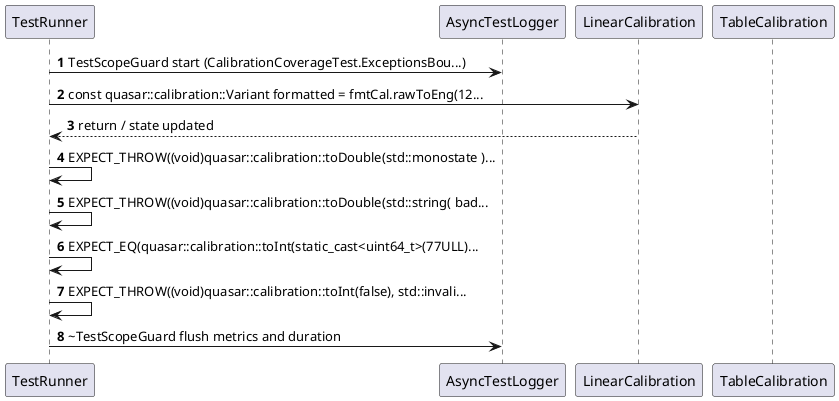

# Test Case: `CalibrationCoverageTest.ExceptionsBoundariesAndAllCalibrations`

| Property | Value |
| :--- | :--- |
| **Module** | `calibration` |
| **Source File** | `cmake-projects/calibration/test/TestCalibrationExtended.cpp` (lines 177–213) |
| **Category** | Coverage, Enum, Boundary & Exception Containment (`CS-0100.1`, `CS-0100.3`, `CS-0100.4`, `CS-0100.6`, `CS-0100.9`) |
| **Traceability** | `TSK-20261113-004,`, `FE-0050,`, `CS-0090.1,` |
| **Async Telemetry** | Enabled (`TestScopeGuard` + `AsyncTestLogger`) |

## Summary

Verifies all calibration classes, variants (`EnumCalibration`, `FormatCalibration`, `CompositeCalibration`), and error paths.

## Sequence Diagram

## Observed Operations

- `const quasar::calibration::Variant formatted = fmtCal.rawToEng(12.345)`

## Verification Assertions

- `EXPECT_THROW((void)quasar::calibration::toDouble(std::monostate{}), std::invalid_argument)`
- `EXPECT_THROW((void)quasar::calibration::toDouble(std::string("bad")), std::invalid_argument)`
- `EXPECT_EQ(quasar::calibration::toInt(static_cast<uint64_t>(77ULL)), 77)`
- `EXPECT_THROW((void)quasar::calibration::toInt(false), std::invalid_argument)`
- `EXPECT_THROW((void)quasar::calibration::LinearCalibration(0.0, 5.0), std::invalid_argument)`
- `EXPECT_THROW(`
- `EXPECT_EQ(std::get<std::string>(statusEnum.rawToEng(static_cast<int64_t>(1))), "RUN")`
- `EXPECT_EQ(std::get<int64_t>(statusEnum.engToRaw(std::string("FAULT"))), 2)`
- `EXPECT_EQ(std::get<std::string>(formatted), "12.35 V")`
- `EXPECT_EQ(pipeline->getType(), "CompositeCalibration")`

---

[Back to `calibration` Tests Overview](../calibration.md)
