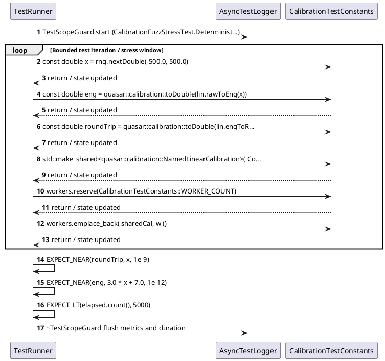

# Test Case: `CalibrationFuzzStressTest.DeterministicRoundTripFuzzAndParallelReads`

| Property | Value |
| :--- | :--- |
| **Module** | `calibration` |
| **Source File** | `cmake-projects/calibration/test/TestCalibrationExtended.cpp` (lines 222–256) |
| **Category** | Determinism, Fuzzing, Concurrency & Stress (`CS-0100.7`, `CS-0100.10`, `CS-0100.11`, `CS-0100.12`) |
| **Traceability** | `TSK-20261113-004,`, `FE-0050,`, `CS-0090.1,` |
| **Async Telemetry** | Enabled (`TestScopeGuard` + `AsyncTestLogger`) |

## Summary

Deterministic seeded fuzzing of invertible linear and monotonic table calibrations.

## Sequence Diagram

## Observed Operations

- `const double x = rng.nextDouble(-500.0, 500.0)`
- `const double eng = quasar::calibration::toDouble(lin.rawToEng(x))`
- `const double roundTrip = quasar::calibration::toDouble(lin.engToRaw(eng))`
- `std::make_shared<quasar::calibration::NamedLinearCalibration>("ConcurrentGain", 3.0, 7.0)`
- `workers.reserve(CalibrationTestConstants::WORKER_COUNT)`
- `workers.emplace_back([&sharedCal, w]() {`
- `const double eng = quasar::calibration::toDouble(sharedCal->rawToEng(x))`
- `workers[w].join()`

## Verification Assertions

- `EXPECT_NEAR(roundTrip, x, 1e-9)`
- `EXPECT_NEAR(eng, 3.0 * x + 7.0, 1e-12)`
- `EXPECT_LT(elapsed.count(), 5000)`

---

[Back to `calibration` Tests Overview](../calibration.md)
