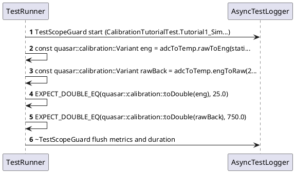

# Test Case: `CalibrationTutorialTest.Tutorial1_SimpleLinearTransform`

| Property | Value |
| :--- | :--- |
| **Module** | `calibration` |
| **Source File** | `cmake-projects/calibration/test/TestCalibrationExtended.cpp` (lines 65–77) |
| **Category** | Pedagogical Tutorial (`CS-0100.19`) |
| **Traceability** | `TSK-20261113-004,`, `FE-0050,`, `CS-0090.1,` |
| **Async Telemetry** | Enabled (`TestScopeGuard` + `AsyncTestLogger`) |

## Summary

Tutorial 1 (Basic): Linear scale/offset calibration and inverse recovery.

## Sequence Diagram

## Observed Operations

- `const quasar::calibration::Variant eng = adcToTemp.rawToEng(static_cast<int64_t>(750))`
- `const quasar::calibration::Variant rawBack = adcToTemp.engToRaw(25.0)`

## Verification Assertions

- `EXPECT_DOUBLE_EQ(quasar::calibration::toDouble(eng), 25.0)`
- `EXPECT_DOUBLE_EQ(quasar::calibration::toDouble(rawBack), 750.0)`

---

[Back to `calibration` Tests Overview](../calibration.md)
