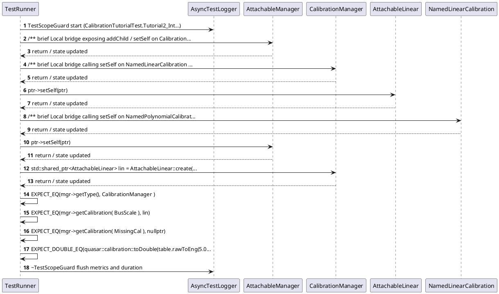

# Test Case: `CalibrationTutorialTest.Tutorial2_IntermediateNamedManagerAndTable`

| Property | Value |
| :--- | :--- |
| **Module** | `calibration` |
| **Source File** | `cmake-projects/calibration/test/TestCalibrationExtended.cpp` (lines 86–131) |
| **Category** | Pedagogical Tutorial (`CS-0100.19`) |
| **Traceability** | `TSK-20261113-004,`, `FE-0050,`, `CS-0090.1,` |
| **Async Telemetry** | Enabled (`TestScopeGuard` + `AsyncTestLogger`) |

## Summary

Tutorial 2 (Intermediate): Organize named calibrations in `CalibrationManager` + piecewise table.

## Sequence Diagram

## Observed Operations

- `/** @brief Local bridge exposing `addChild`/`setSelf` on `CalibrationManager` for attachment (`CS-0090.1`). */`
- `/** @brief Local bridge calling `setSelf` on `NamedLinearCalibration` so `as<NamedCalibration>()` works (`CS-0090.1`). */`
- `ptr->setSelf(ptr)`
- `/** @brief Local bridge calling `setSelf` on `NamedPolynomialCalibration` so `as<NamedCalibration>()` works (`CS-0090.1`). */`
- `ptr->setSelf(ptr)`
- `std::shared_ptr<AttachableLinear> lin = AttachableLinear::create("BusScale", 2.0, 1.5)`
- `AttachablePoly::create("Thermistor", std::vector<double>{1.0, 2.0, 0.5})`
- `mgr->attach(lin)`

## Verification Assertions

- `EXPECT_EQ(mgr->getType(), "CalibrationManager")`
- `EXPECT_EQ(mgr->getCalibration("BusScale"), lin)`
- `EXPECT_EQ(mgr->getCalibration("MissingCal"), nullptr)`
- `EXPECT_DOUBLE_EQ(quasar::calibration::toDouble(table.rawToEng(5.0)), 50.0)`
- `EXPECT_DOUBLE_EQ(quasar::calibration::toDouble(table.rawToEng(15.0)), 200.0)`
- `EXPECT_DOUBLE_EQ(quasar::calibration::toDouble(table.rawToEng(-5.0)), 0.0)`
- `EXPECT_DOUBLE_EQ(quasar::calibration::toDouble(table.rawToEng(25.0)), 300.0)`

---

[Back to `calibration` Tests Overview](../calibration.md)
