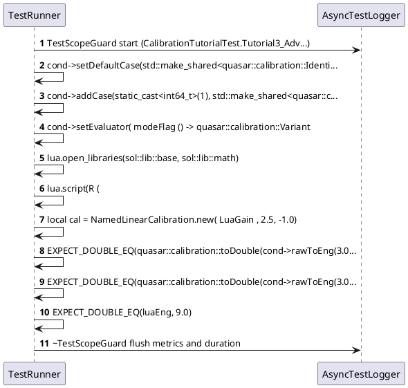

# Test Case: `CalibrationTutorialTest.Tutorial3_AdvancedConditionalAndLuaBindings`

| Property | Value |
| :--- | :--- |
| **Module** | `calibration` |
| **Source File** | `cmake-projects/calibration/test/TestCalibrationExtended.cpp` (lines 140–164) |
| **Category** | Pedagogical Tutorial (`CS-0100.19`) |
| **Traceability** | `TSK-20261113-004,`, `FE-0050,`, `CS-0090.1,` |
| **Async Telemetry** | Enabled (`TestScopeGuard` + `AsyncTestLogger`) |

## Summary

Tutorial 3 (Advanced): `ConditionalCalibration` dispatch combined with Lua usertype bindings.

## Sequence Diagram

## Observed Operations

- `cond->setDefaultCase(std::make_shared<quasar::calibration::IdentityCalibration>())`
- `cond->addCase(static_cast<int64_t>(1), std::make_shared<quasar::calibration::LinearCalibration>(10.0, 0.0))`
- `cond->setEvaluator([&modeFlag]() -> quasar::calibration::Variant {`
- `lua.open_libraries(sol::lib::base, sol::lib::math)`
- `lua.script(R"(`
- `local cal = NamedLinearCalibration.new("LuaGain", 2.5, -1.0)`
- `lua_eng = cal:rawToEng(4.0)`

## Verification Assertions

- `EXPECT_DOUBLE_EQ(quasar::calibration::toDouble(cond->rawToEng(3.0)), 30.0)`
- `EXPECT_DOUBLE_EQ(quasar::calibration::toDouble(cond->rawToEng(3.0)), 3.0)`
- `EXPECT_DOUBLE_EQ(luaEng, 9.0)`

---

[Back to `calibration` Tests Overview](../calibration.md)
