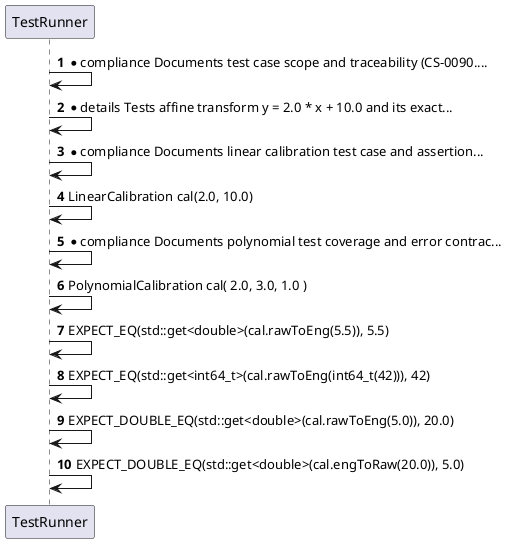

# Test Case: `quasar_calibration_test`

| Property | Value |
| :--- | :--- |
| **Module** | `calibration` |
| **Source File** | `cmake-projects/calibration/test/TestCalibrations.cpp` (lines 1–96) |
| **Category** | Unit & Regression Verification |
| **Traceability** | `TSK-20261113-003,`, `FE-0050,` |
| **Async Telemetry** | Standard GTest / CTest stdout |

## Summary

GoogleTest unit tests verifying core Quasar calibration algorithms and error handling.

## Sequence Diagram

## Observed Operations

- `* @compliance Documents test case scope and traceability (CS-0090.1, CS-0090.2, CS-0090.5).`
- `* @details Tests affine transform y = 2.0 * x + 10.0 and its exact inverse x = (y - 10.0) / 2.0.`
- `* @compliance Documents linear calibration test case and assertions (CS-0090.1, CS-0090.2, CS-0090.5).`
- `LinearCalibration cal(2.0, 10.0)`
- `* @compliance Documents polynomial test coverage and error contract verification (CS-0090.1, CS-0090.2, CS-0090.5).`
- `PolynomialCalibration cal({2.0, 3.0, 1.0})`
- `* @compliance Documents bidirectional enum mapping test assertions (CS-0090.1, CS-0090.2, CS-0090.5).`
- `* @compliance Documents string-formatting calibration test coverage (CS-0090.1, CS-0090.2, CS-0090.5).`

## Verification Assertions

- `EXPECT_EQ(std::get<double>(cal.rawToEng(5.5)), 5.5)`
- `EXPECT_EQ(std::get<int64_t>(cal.rawToEng(int64_t(42))), 42)`
- `EXPECT_DOUBLE_EQ(std::get<double>(cal.rawToEng(5.0)), 20.0)`
- `EXPECT_DOUBLE_EQ(std::get<double>(cal.engToRaw(20.0)), 5.0)`
- `EXPECT_DOUBLE_EQ(std::get<double>(cal.rawToEng(2.0)), 12.0)`
- `EXPECT_THROW(cal.engToRaw(12.0), std::logic_error)`
- `EXPECT_EQ(std::get<std::string>(cal.rawToEng(int64_t(0))), "OFF")`
- `EXPECT_EQ(std::get<int64_t>(cal.engToRaw("ON")), 1)`
- `EXPECT_THROW(cal.rawToEng(int64_t(2)), std::invalid_argument)`
- `EXPECT_THROW(cal.engToRaw("UNKNOWN"), std::invalid_argument)`

---

[Back to `calibration` Tests Overview](../calibration.md)
