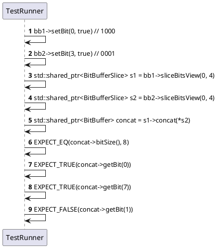

# Test Case: `BitBufferSliceTest.Concat`

| Property | Value |
| :--- | :--- |
| **Module** | `coretypes` |
| **Source File** | `cmake-projects/coretypes/test/TestBitBufferSlice.cpp` (lines 72–104) |
| **Category** | Unit & Regression Verification |
| **Traceability** | See module specification (`FE-*` / `TSK-*`) |
| **Async Telemetry** | Standard GTest / CTest stdout |

## Summary

Executes verification scenario `BitBufferSliceTest.Concat` defined in `cmake-projects/coretypes/test/TestBitBufferSlice.cpp`.

## Sequence Diagram

## Observed Operations

- `bb1->setBit(0, true); // 1000`
- `bb2->setBit(3, true); // 0001`
- `std::shared_ptr<BitBufferSlice> s1 = bb1->sliceBitsView(0, 4)`
- `std::shared_ptr<BitBufferSlice> s2 = bb2->sliceBitsView(0, 4)`
- `std::shared_ptr<BitBuffer> concat = s1->concat(*s2)`

## Verification Assertions

- `EXPECT_EQ(concat->bitSize(), 8)`
- `EXPECT_TRUE(concat->getBit(0))`
- `EXPECT_TRUE(concat->getBit(7))`
- `EXPECT_FALSE(concat->getBit(1))`

---

[Back to `coretypes` Tests Overview](../coretypes.md)
