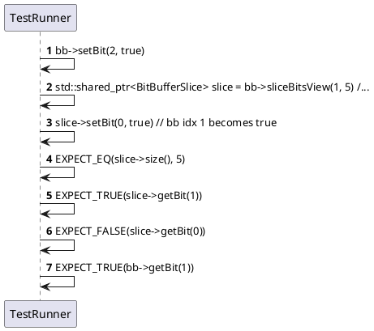

# Test Case: `BitBufferSliceTest.SubSlice`

| Property | Value |
| :--- | :--- |
| **Module** | `coretypes` |
| **Source File** | `cmake-projects/coretypes/test/TestBitBufferSlice.cpp` (lines 38–70) |
| **Category** | Unit & Regression Verification |
| **Traceability** | See module specification (`FE-*` / `TSK-*`) |
| **Async Telemetry** | Standard GTest / CTest stdout |

## Summary

Executes verification scenario `BitBufferSliceTest.SubSlice` defined in `cmake-projects/coretypes/test/TestBitBufferSlice.cpp`.

## Sequence Diagram

## Observed Operations

- `bb->setBit(2, true)`
- `std::shared_ptr<BitBufferSlice> slice = bb->sliceBitsView(1, 5); // bits 1..5`
- `slice->setBit(0, true); // bb idx 1 becomes true`

## Verification Assertions

- `EXPECT_EQ(slice->size(), 5)`
- `EXPECT_TRUE(slice->getBit(1))`
- `EXPECT_FALSE(slice->getBit(0))`
- `EXPECT_TRUE(bb->getBit(1))`

---

[Back to `coretypes` Tests Overview](../coretypes.md)
