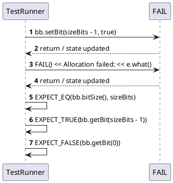

# Test Case: `BitBufferStress.LargeAllocation`

| Property | Value |
| :--- | :--- |
| **Module** | `coretypes` |
| **Source File** | `cmake-projects/coretypes/test/TestBitBufferStress.cpp` (lines 8–43) |
| **Category** | Determinism, Fuzzing, Concurrency & Stress (`CS-0100.7`, `CS-0100.10`, `CS-0100.11`, `CS-0100.12`) |
| **Traceability** | See module specification (`FE-*` / `TSK-*`) |
| **Async Telemetry** | Standard GTest / CTest stdout |

## Summary

Executes verification scenario `BitBufferStress.LargeAllocation` defined in `cmake-projects/coretypes/test/TestBitBufferStress.cpp`.

## Sequence Diagram

## Observed Operations

- `bb.setBit(sizeBits - 1, true)`
- `FAIL() << "Allocation failed: " << e.what()`

## Verification Assertions

- `EXPECT_EQ(bb.bitSize(), sizeBits)`
- `EXPECT_TRUE(bb.getBit(sizeBits - 1))`
- `EXPECT_FALSE(bb.getBit(0))`

---

[Back to `coretypes` Tests Overview](../coretypes.md)
