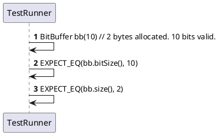

# Test Case: `BitBufferTest.BitSize`

| Property | Value |
| :--- | :--- |
| **Module** | `coretypes` |
| **Source File** | `cmake-projects/coretypes/test/TestBitBuffer.cpp` (lines 38–51) |
| **Category** | Unit & Regression Verification |
| **Traceability** | See module specification (`FE-*` / `TSK-*`) |
| **Async Telemetry** | Standard GTest / CTest stdout |

## Summary

Executes verification scenario `BitBufferTest.BitSize` defined in `cmake-projects/coretypes/test/TestBitBuffer.cpp`.

## Sequence Diagram

## Observed Operations

- `BitBuffer bb(10); // 2 bytes allocated. 10 bits valid.`

## Verification Assertions

- `EXPECT_EQ(bb.bitSize(), 10)`
- `EXPECT_EQ(bb.size(), 2)`

---

[Back to `coretypes` Tests Overview](../coretypes.md)
