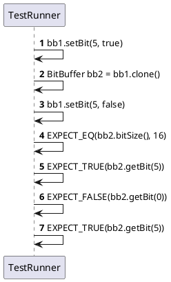

# Test Case: `BitBufferTest.Clone`

| Property | Value |
| :--- | :--- |
| **Module** | `coretypes` |
| **Source File** | `cmake-projects/coretypes/test/TestBitBuffer.cpp` (lines 238–266) |
| **Category** | Unit & Regression Verification |
| **Traceability** | See module specification (`FE-*` / `TSK-*`) |
| **Async Telemetry** | Standard GTest / CTest stdout |

## Summary

Executes verification scenario `BitBufferTest.Clone` defined in `cmake-projects/coretypes/test/TestBitBuffer.cpp`.

## Sequence Diagram

## Observed Operations

- `bb1.setBit(5, true)`
- `BitBuffer bb2 = bb1.clone()`
- `bb1.setBit(5, false)`

## Verification Assertions

- `EXPECT_EQ(bb2.bitSize(), 16)`
- `EXPECT_TRUE(bb2.getBit(5))`
- `EXPECT_FALSE(bb2.getBit(0))`
- `EXPECT_TRUE(bb2.getBit(5))`

---

[Back to `coretypes` Tests Overview](../coretypes.md)
