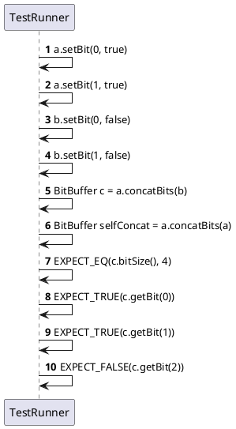

# Test Case: `BitBufferTest.ConcatBits`

| Property | Value |
| :--- | :--- |
| **Module** | `coretypes` |
| **Source File** | `cmake-projects/coretypes/test/TestBitBuffer.cpp` (lines 75–118) |
| **Category** | Unit & Regression Verification |
| **Traceability** | See module specification (`FE-*` / `TSK-*`) |
| **Async Telemetry** | Standard GTest / CTest stdout |

## Summary

Executes verification scenario `BitBufferTest.ConcatBits` defined in `cmake-projects/coretypes/test/TestBitBuffer.cpp`.

## Sequence Diagram

## Observed Operations

- `a.setBit(0, true)`
- `a.setBit(1, true)`
- `b.setBit(0, false)`
- `b.setBit(1, false)`
- `BitBuffer c = a.concatBits(b)`
- `BitBuffer selfConcat = a.concatBits(a)`

## Verification Assertions

- `EXPECT_EQ(c.bitSize(), 4)`
- `EXPECT_TRUE(c.getBit(0))`
- `EXPECT_TRUE(c.getBit(1))`
- `EXPECT_FALSE(c.getBit(2))`
- `EXPECT_FALSE(c.getBit(3))`
- `EXPECT_EQ(selfConcat.bitSize(), 4)`
- `EXPECT_TRUE(selfConcat.getBit(0))`
- `EXPECT_TRUE(selfConcat.getBit(1))`
- `EXPECT_TRUE(selfConcat.getBit(2))`
- `EXPECT_TRUE(selfConcat.getBit(3))`

---

[Back to `coretypes` Tests Overview](../coretypes.md)
