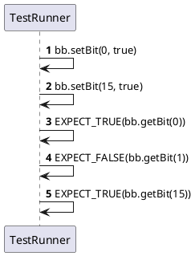

# Test Case: `BitBufferTest.GetSetBit`

| Property | Value |
| :--- | :--- |
| **Module** | `coretypes` |
| **Source File** | `cmake-projects/coretypes/test/TestBitBuffer.cpp` (lines 11–36) |
| **Category** | Unit & Regression Verification |
| **Traceability** | See module specification (`FE-*` / `TSK-*`) |
| **Async Telemetry** | Standard GTest / CTest stdout |

## Summary

Executes verification scenario `BitBufferTest.GetSetBit` defined in `cmake-projects/coretypes/test/TestBitBuffer.cpp`.

## Sequence Diagram

## Observed Operations

- `bb.setBit(0, true)`
- `bb.setBit(15, true)`

## Verification Assertions

- `EXPECT_TRUE(bb.getBit(0))`
- `EXPECT_FALSE(bb.getBit(1))`
- `EXPECT_TRUE(bb.getBit(15))`

---

[Back to `coretypes` Tests Overview](../coretypes.md)
