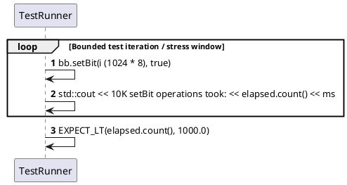

# Test Case: `BitBufferTest.Performance_GetSet`

| Property | Value |
| :--- | :--- |
| **Module** | `coretypes` |
| **Source File** | `cmake-projects/coretypes/test/TestBitBuffer.cpp` (lines 268–292) |
| **Category** | Determinism, Fuzzing, Concurrency & Stress (`CS-0100.7`, `CS-0100.10`, `CS-0100.11`, `CS-0100.12`) |
| **Traceability** | See module specification (`FE-*` / `TSK-*`) |
| **Async Telemetry** | Standard GTest / CTest stdout |

## Summary

Executes verification scenario `BitBufferTest.Performance_GetSet` defined in `cmake-projects/coretypes/test/TestBitBuffer.cpp`.

## Sequence Diagram

## Observed Operations

- `bb.setBit(i % (1024 * 8), true)`
- `std::cout << "10K setBit operations took: " << elapsed.count() << " ms"`

## Verification Assertions

- `EXPECT_LT(elapsed.count(), 1000.0)`

---

[Back to `coretypes` Tests Overview](../coretypes.md)
