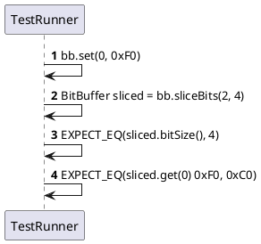

# Test Case: `BitBufferTest.SliceBits`

| Property | Value |
| :--- | :--- |
| **Module** | `coretypes` |
| **Source File** | `cmake-projects/coretypes/test/TestBitBuffer.cpp` (lines 53–73) |
| **Category** | Unit & Regression Verification |
| **Traceability** | See module specification (`FE-*` / `TSK-*`) |
| **Async Telemetry** | Standard GTest / CTest stdout |

## Summary

Executes verification scenario `BitBufferTest.SliceBits` defined in `cmake-projects/coretypes/test/TestBitBuffer.cpp`.

## Sequence Diagram

## Observed Operations

- `bb.set(0, 0xF0)`
- `BitBuffer sliced = bb.sliceBits(2, 4)`

## Verification Assertions

- `EXPECT_EQ(sliced.bitSize(), 4)`
- `EXPECT_EQ(sliced.get(0) & 0xF0, 0xC0)`

---

[Back to `coretypes` Tests Overview](../coretypes.md)
