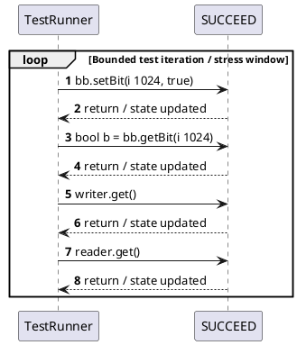

# Test Case: `BitBufferTest.ThreadSafety`

| Property | Value |
| :--- | :--- |
| **Module** | `coretypes` |
| **Source File** | `cmake-projects/coretypes/test/TestBitBuffer.cpp` (lines 294–338) |
| **Category** | Determinism, Fuzzing, Concurrency & Stress (`CS-0100.7`, `CS-0100.10`, `CS-0100.11`, `CS-0100.12`) |
| **Traceability** | See module specification (`FE-*` / `TSK-*`) |
| **Async Telemetry** | Standard GTest / CTest stdout |

## Summary

Executes verification scenario `BitBufferTest.ThreadSafety` defined in `cmake-projects/coretypes/test/TestBitBuffer.cpp`.

## Sequence Diagram

## Observed Operations

- `bb.setBit(i % 1024, true)`
- `bool b = bb.getBit(i % 1024)`
- `writer.get()`
- `reader.get()`

## Verification Assertions

- Verified via exit status `0` and runtime checks inside executable.

---

[Back to `coretypes` Tests Overview](../coretypes.md)
