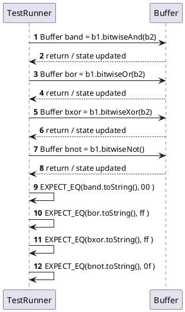

# Test Case: `BufferTest.BitwiseOps`

| Property | Value |
| :--- | :--- |
| **Module** | `coretypes` |
| **Source File** | `cmake-projects/coretypes/test/TestBuffer.cpp` (lines 242–279) |
| **Category** | Unit & Regression Verification |
| **Traceability** | See module specification (`FE-*` / `TSK-*`) |
| **Async Telemetry** | Standard GTest / CTest stdout |

## Summary

Executes verification scenario `BufferTest.BitwiseOps` defined in `cmake-projects/coretypes/test/TestBuffer.cpp`.

## Sequence Diagram

## Observed Operations

- `Buffer band = b1.bitwiseAnd(b2)`
- `Buffer bor = b1.bitwiseOr(b2)`
- `Buffer bxor = b1.bitwiseXor(b2)`
- `Buffer bnot = b1.bitwiseNot()`

## Verification Assertions

- `EXPECT_EQ(band.toString(), "00")`
- `EXPECT_EQ(bor.toString(), "ff")`
- `EXPECT_EQ(bxor.toString(), "ff")`
- `EXPECT_EQ(bnot.toString(), "0f")`
- `EXPECT_THROW(b1.bitwiseAnd(b4), std::invalid_argument)`

---

[Back to `coretypes` Tests Overview](../coretypes.md)
