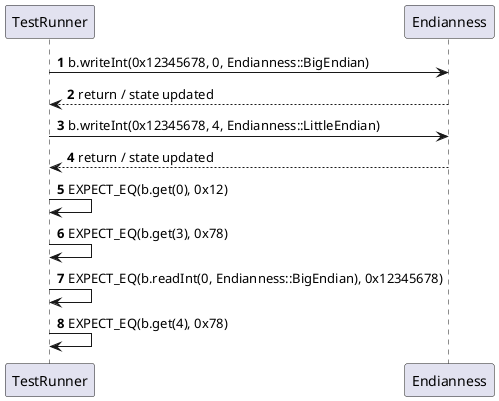

# Test Case: `BufferTest.NumericIO`

| Property | Value |
| :--- | :--- |
| **Module** | `coretypes` |
| **Source File** | `cmake-projects/coretypes/test/TestBuffer.cpp` (lines 89–124) |
| **Category** | Unit & Regression Verification |
| **Traceability** | See module specification (`FE-*` / `TSK-*`) |
| **Async Telemetry** | Standard GTest / CTest stdout |

## Summary

Executes verification scenario `BufferTest.NumericIO` defined in `cmake-projects/coretypes/test/TestBuffer.cpp`.

## Sequence Diagram

## Observed Operations

- `b.writeInt(0x12345678, 0, Endianness::BigEndian)`
- `b.writeInt(0x12345678, 4, Endianness::LittleEndian)`

## Verification Assertions

- `EXPECT_EQ(b.get(0), 0x12)`
- `EXPECT_EQ(b.get(3), 0x78)`
- `EXPECT_EQ(b.readInt(0, Endianness::BigEndian), 0x12345678)`
- `EXPECT_EQ(b.get(4), 0x78)`
- `EXPECT_EQ(b.get(7), 0x12)`
- `EXPECT_EQ(b.readInt(4, Endianness::LittleEndian), 0x12345678)`

---

[Back to `coretypes` Tests Overview](../coretypes.md)
