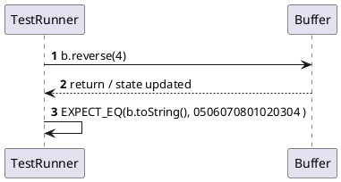

# Test Case: `BufferTest.ReverseWord`

| Property | Value |
| :--- | :--- |
| **Module** | `coretypes` |
| **Source File** | `cmake-projects/coretypes/test/TestBuffer.cpp` (lines 164–176) |
| **Category** | Unit & Regression Verification |
| **Traceability** | See module specification (`FE-*` / `TSK-*`) |
| **Async Telemetry** | Standard GTest / CTest stdout |

## Summary

Executes verification scenario `BufferTest.ReverseWord` defined in `cmake-projects/coretypes/test/TestBuffer.cpp`.

## Sequence Diagram

## Observed Operations

- `b.reverse(4)`

## Verification Assertions

- `EXPECT_EQ(b.toString(), "0506070801020304")`

---

[Back to `coretypes` Tests Overview](../coretypes.md)
