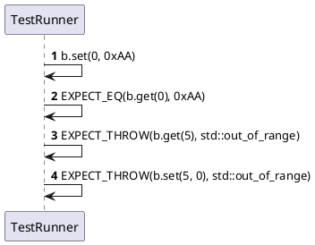

# Test Case: `BufferTest.SetGet`

| Property | Value |
| :--- | :--- |
| **Module** | `coretypes` |
| **Source File** | `cmake-projects/coretypes/test/TestBuffer.cpp` (lines 33–54) |
| **Category** | Unit & Regression Verification |
| **Traceability** | See module specification (`FE-*` / `TSK-*`) |
| **Async Telemetry** | Standard GTest / CTest stdout |

## Summary

Executes verification scenario `BufferTest.SetGet` defined in `cmake-projects/coretypes/test/TestBuffer.cpp`.

## Sequence Diagram

## Observed Operations

- `b.set(0, 0xAA)`

## Verification Assertions

- `EXPECT_EQ(b.get(0), 0xAA)`
- `EXPECT_THROW(b.get(5), std::out_of_range)`
- `EXPECT_THROW(b.set(5, 0), std::out_of_range)`

---

[Back to `coretypes` Tests Overview](../coretypes.md)
