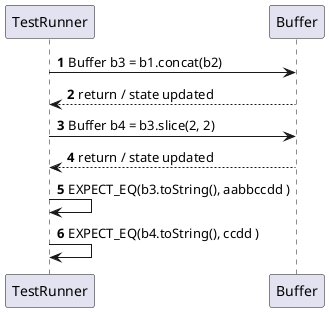

# Test Case: `BufferTest.SliceConcat`

| Property | Value |
| :--- | :--- |
| **Module** | `coretypes` |
| **Source File** | `cmake-projects/coretypes/test/TestBuffer.cpp` (lines 126–150) |
| **Category** | Unit & Regression Verification |
| **Traceability** | See module specification (`FE-*` / `TSK-*`) |
| **Async Telemetry** | Standard GTest / CTest stdout |

## Summary

Executes verification scenario `BufferTest.SliceConcat` defined in `cmake-projects/coretypes/test/TestBuffer.cpp`.

## Sequence Diagram

## Observed Operations

- `Buffer b3 = b1.concat(b2)`
- `Buffer b4 = b3.slice(2, 2)`

## Verification Assertions

- `EXPECT_EQ(b3.toString(), "aabbccdd")`
- `EXPECT_EQ(b4.toString(), "ccdd")`

---

[Back to `coretypes` Tests Overview](../coretypes.md)
