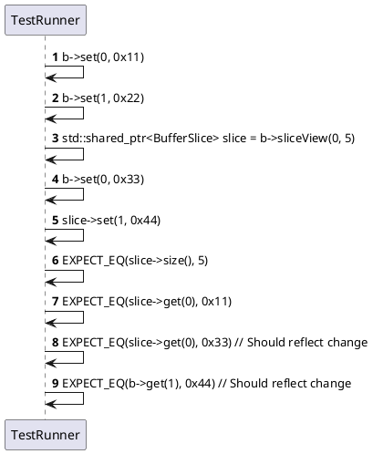

# Test Case: `BufferTest.SliceView`

| Property | Value |
| :--- | :--- |
| **Module** | `coretypes` |
| **Source File** | `cmake-projects/coretypes/test/TestBuffer.cpp` (lines 204–240) |
| **Category** | Unit & Regression Verification |
| **Traceability** | See module specification (`FE-*` / `TSK-*`) |
| **Async Telemetry** | Standard GTest / CTest stdout |

## Summary

Executes verification scenario `BufferTest.SliceView` defined in `cmake-projects/coretypes/test/TestBuffer.cpp`.

## Sequence Diagram

## Observed Operations

- `b->set(0, 0x11)`
- `b->set(1, 0x22)`
- `std::shared_ptr<BufferSlice> slice = b->sliceView(0, 5)`
- `b->set(0, 0x33)`
- `slice->set(1, 0x44)`

## Verification Assertions

- `EXPECT_EQ(slice->size(), 5)`
- `EXPECT_EQ(slice->get(0), 0x11)`
- `EXPECT_EQ(slice->get(0), 0x33); // Should reflect change`
- `EXPECT_EQ(b->get(1), 0x44); // Should reflect change`

---

[Back to `coretypes` Tests Overview](../coretypes.md)
