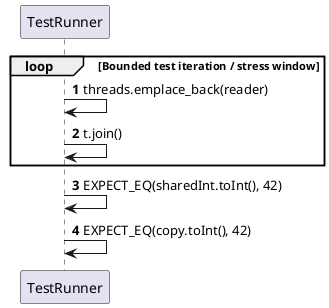

# Test Case: `CoreTypesThreadSafety.IntegerImmutable`

| Property | Value |
| :--- | :--- |
| **Module** | `coretypes` |
| **Source File** | `cmake-projects/coretypes/test/TestThreadSafety.cpp` (lines 11–51) |
| **Category** | Determinism, Fuzzing, Concurrency & Stress (`CS-0100.7`, `CS-0100.10`, `CS-0100.11`, `CS-0100.12`) |
| **Traceability** | See module specification (`FE-*` / `TSK-*`) |
| **Async Telemetry** | Standard GTest / CTest stdout |

## Summary

Executes verification scenario `CoreTypesThreadSafety.IntegerImmutable` defined in `cmake-projects/coretypes/test/TestThreadSafety.cpp`.

## Sequence Diagram

## Observed Operations

- `threads.emplace_back(reader)`
- `t.join()`

## Verification Assertions

- `EXPECT_EQ(sharedInt.toInt(), 42)`
- `EXPECT_EQ(copy.toInt(), 42)`

---

[Back to `coretypes` Tests Overview](../coretypes.md)
