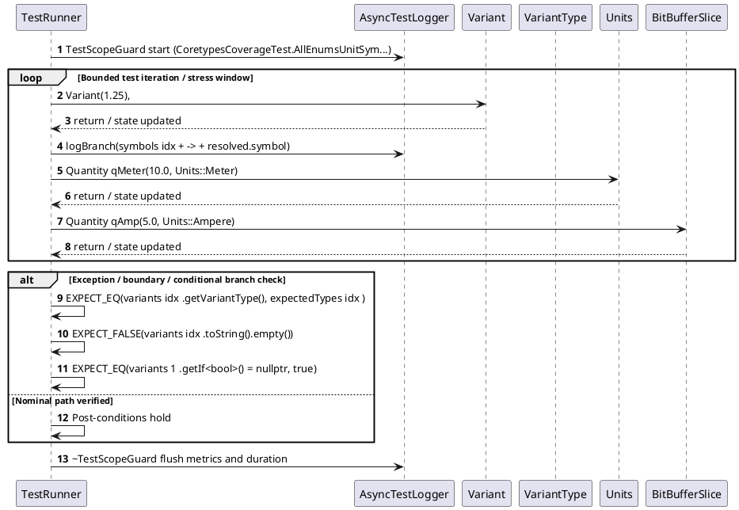

# Test Case: `CoretypesCoverageTest.AllEnumsUnitSymbolsAndExceptionBoundaries`

| Property | Value |
| :--- | :--- |
| **Module** | `coretypes` |
| **Source File** | `cmake-projects/coretypes/test_cs0100/TestCoretypesExtended.cpp` (lines 231–301) |
| **Category** | Coverage, Enum, Boundary & Exception Containment (`CS-0100.1`, `CS-0100.3`, `CS-0100.4`, `CS-0100.6`, `CS-0100.9`) |
| **Traceability** | `[TSK-20260308-001]`, `[FE-0030]`, `[FE-0110]`, `[CS-0040.2]` |
| **Async Telemetry** | Enabled (`TestScopeGuard` + `AsyncTestLogger`) |

## Summary

Extended CS-0100 test suite for `quasar_coretypes` (tutorials, 20+ templates, temporal/unit boundaries, fuzz & stress).

## Sequence Diagram

## Observed Operations

- `Variant(1.25),`
- `logBranch(symbols[idx] + "->" + resolved.symbol)`
- `Quantity qMeter(10.0, Units::Meter)`
- `Quantity qAmp(5.0, Units::Ampere)`

## Verification Assertions

- `EXPECT_EQ(variants[idx].getVariantType(), expectedTypes[idx])`
- `EXPECT_FALSE(variants[idx].toString().empty())`
- `EXPECT_EQ(variants[1].getIf<bool>() != nullptr, true)`
- `EXPECT_EQ(variants[1].getIf<int64_t>(), nullptr)`
- `EXPECT_THROW((void)variants[0].getAs<int64_t>(), std::bad_variant_access)`
- `EXPECT_TRUE(resolved.symbol.empty())`
- `EXPECT_FALSE(resolved.symbol.empty())`
- `EXPECT_THROW((void)qMeter.convertTo(Units::Second), std::invalid_argument)`
- `EXPECT_THROW((void)(qMeter + qAmp), std::invalid_argument)`
- `EXPECT_THROW(BitBufferSlice(emptyBuf, 0U, 8U), std::invalid_argument)`

---

[Back to `coretypes` Tests Overview](../coretypes.md)
