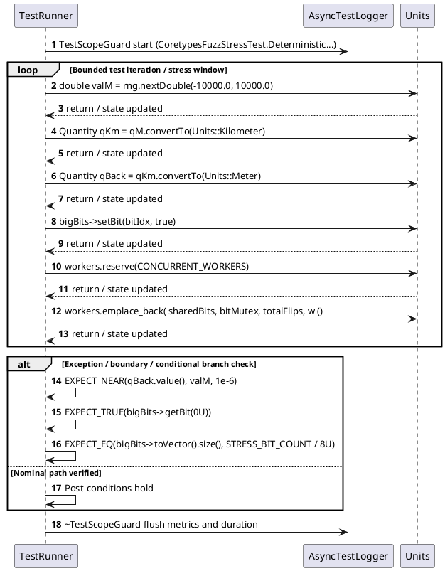

# Test Case: `CoretypesFuzzStressTest.DeterministicQuantityFuzzAndConcurrentBitBufferStress`

| Property | Value |
| :--- | :--- |
| **Module** | `coretypes` |
| **Source File** | `cmake-projects/coretypes/test_cs0100/TestCoretypesExtended.cpp` (lines 303–369) |
| **Category** | Determinism, Fuzzing, Concurrency & Stress (`CS-0100.7`, `CS-0100.10`, `CS-0100.11`, `CS-0100.12`) |
| **Traceability** | `[TSK-20260308-001]`, `[FE-0030]`, `[FE-0110]`, `[CS-0040.2]` |
| **Async Telemetry** | Enabled (`TestScopeGuard` + `AsyncTestLogger`) |

## Summary

Extended CS-0100 test suite for `quasar_coretypes` (tutorials, 20+ templates, temporal/unit boundaries, fuzz & stress).

## Sequence Diagram

## Observed Operations

- `double valM = rng.nextDouble(-10000.0, 10000.0)`
- `Quantity qKm = qM.convertTo(Units::Kilometer)`
- `Quantity qBack = qKm.convertTo(Units::Meter)`
- `bigBits->setBit(bitIdx, true)`
- `workers.reserve(CONCURRENT_WORKERS)`
- `workers.emplace_back([&sharedBits, &bitMutex, &totalFlips, w]() {`
- `sharedBits->setBit(bitPos, (step % 2U) == 0U)`
- `workers[w].join()`

## Verification Assertions

- `EXPECT_NEAR(qBack.value(), valM, 1e-6)`
- `EXPECT_TRUE(bigBits->getBit(0U))`
- `EXPECT_EQ(bigBits->toVector().size(), STRESS_BIT_COUNT / 8U)`
- `EXPECT_EQ(totalFlips, CONCURRENT_WORKERS * WORKER_ITERATIONS)`

---

[Back to `coretypes` Tests Overview](../coretypes.md)
