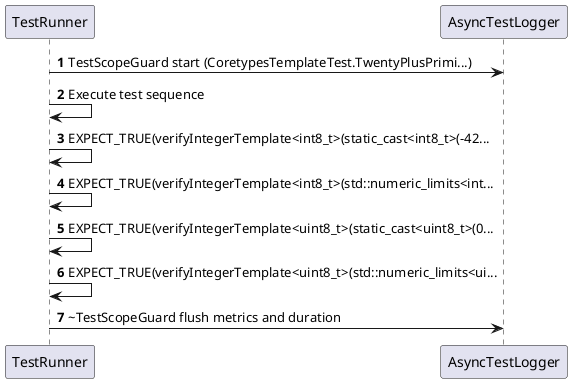

# Test Case: `CoretypesTemplateTest.TwentyPlusPrimitiveTemplateInstantiations`

| Property | Value |
| :--- | :--- |
| **Module** | `coretypes` |
| **Source File** | `cmake-projects/coretypes/test_cs0100/TestCoretypesExtended.cpp` (lines 205–229) |
| **Category** | Template / Polymorphic Breadth (`CS-0100.5`) |
| **Traceability** | `[TSK-20260308-001]`, `[FE-0030]`, `[FE-0110]`, `[CS-0040.2]` |
| **Async Telemetry** | Enabled (`TestScopeGuard` + `AsyncTestLogger`) |

## Summary

Extended CS-0100 test suite for `quasar_coretypes` (tutorials, 20+ templates, temporal/unit boundaries, fuzz & stress).

## Sequence Diagram

## Observed Operations

- Invokes standalone executable entry flow.

## Verification Assertions

- `EXPECT_TRUE(verifyIntegerTemplate<int8_t>(static_cast<int8_t>(-42), "int8_minish"))`
- `EXPECT_TRUE(verifyIntegerTemplate<int8_t>(std::numeric_limits<int8_t>::max(), "int8_max"))`
- `EXPECT_TRUE(verifyIntegerTemplate<uint8_t>(static_cast<uint8_t>(0U), "uint8_zero"))`
- `EXPECT_TRUE(verifyIntegerTemplate<uint8_t>(std::numeric_limits<uint8_t>::max(), "uint8_max"))`
- `EXPECT_TRUE(verifyIntegerTemplate<int16_t>(static_cast<int16_t>(-1234), "int16"))`
- `EXPECT_TRUE(verifyIntegerTemplate<uint16_t>(static_cast<uint16_t>(54321U), "uint16"))`
- `EXPECT_TRUE(verifyIntegerTemplate<int32_t>(-100000, "int32"))`
- `EXPECT_TRUE(verifyIntegerTemplate<uint32_t>(3000000000U, "uint32"))`
- `EXPECT_TRUE(verifyIntegerTemplate<int64_t>(-900000000000LL, "int64"))`
- `EXPECT_TRUE(verifyIntegerTemplate<uint64_t>(18000000000000ULL, "uint64"))`

---

[Back to `coretypes` Tests Overview](../coretypes.md)
