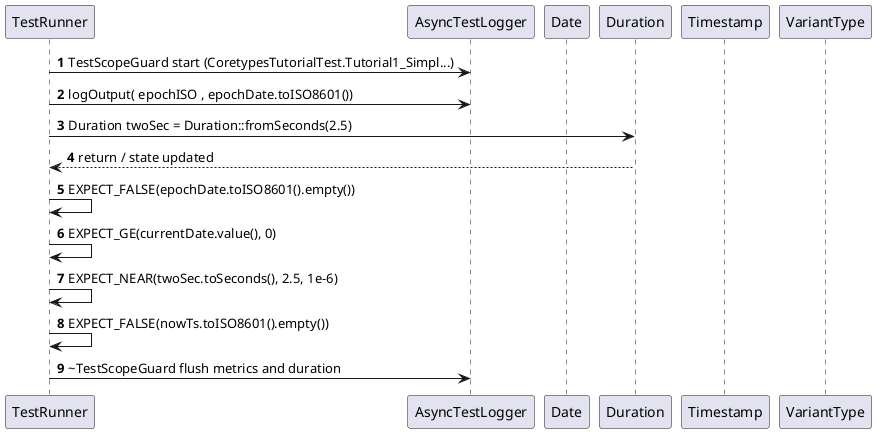

# Test Case: `CoretypesTutorialTest.Tutorial1_SimpleTemporalAndVariantBasics`

| Property | Value |
| :--- | :--- |
| **Module** | `coretypes` |
| **Source File** | `cmake-projects/coretypes/test_cs0100/TestCoretypesExtended.cpp` (lines 129–153) |
| **Category** | Pedagogical Tutorial (`CS-0100.19`) |
| **Traceability** | `[TSK-20260308-001]`, `[FE-0030]`, `[FE-0110]`, `[CS-0040.2]` |
| **Async Telemetry** | Enabled (`TestScopeGuard` + `AsyncTestLogger`) |

## Summary

Extended CS-0100 test suite for `quasar_coretypes` (tutorials, 20+ templates, temporal/unit boundaries, fuzz & stress).

## Sequence Diagram

## Observed Operations

- `logOutput("epochISO", epochDate.toISO8601())`
- `Duration twoSec = Duration::fromSeconds(2.5)`

## Verification Assertions

- `EXPECT_FALSE(epochDate.toISO8601().empty())`
- `EXPECT_GE(currentDate.value(), 0)`
- `EXPECT_NEAR(twoSec.toSeconds(), 2.5, 1e-6)`
- `EXPECT_FALSE(nowTs.toISO8601().empty())`
- `EXPECT_GT(nowTs.value(), 0)`
- `EXPECT_EQ(emptyVar.getVariantType(), VariantType::Empty)`
- `EXPECT_TRUE(intVar.holds<int64_t>())`
- `EXPECT_EQ(intVar.getAs<int64_t>(), 42)`
- `EXPECT_EQ(strVar.toString(), "quasar")`

---

[Back to `coretypes` Tests Overview](../coretypes.md)
