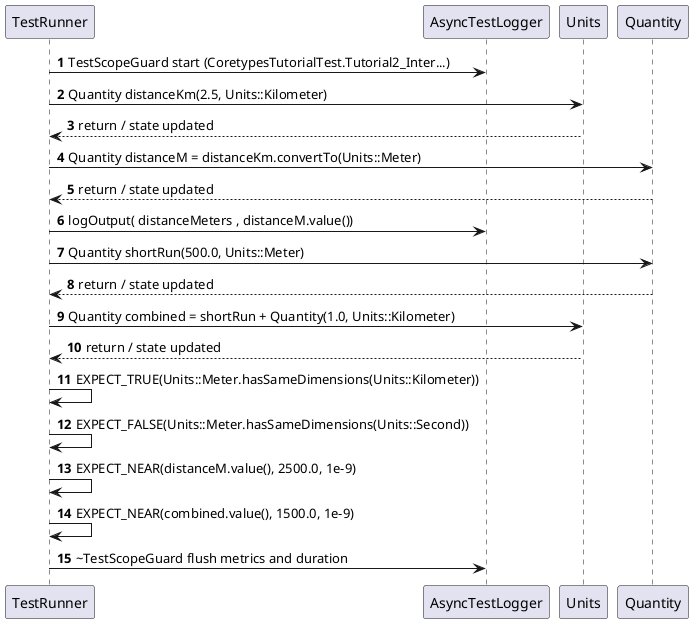

# Test Case: `CoretypesTutorialTest.Tutorial2_IntermediatePhysicalUnitsAndQuantities`

| Property | Value |
| :--- | :--- |
| **Module** | `coretypes` |
| **Source File** | `cmake-projects/coretypes/test_cs0100/TestCoretypesExtended.cpp` (lines 155–176) |
| **Category** | Pedagogical Tutorial (`CS-0100.19`) |
| **Traceability** | `[TSK-20260308-001]`, `[FE-0030]`, `[FE-0110]`, `[CS-0040.2]` |
| **Async Telemetry** | Enabled (`TestScopeGuard` + `AsyncTestLogger`) |

## Summary

Extended CS-0100 test suite for `quasar_coretypes` (tutorials, 20+ templates, temporal/unit boundaries, fuzz & stress).

## Sequence Diagram

## Observed Operations

- `Quantity distanceKm(2.5, Units::Kilometer)`
- `Quantity distanceM = distanceKm.convertTo(Units::Meter)`
- `logOutput("distanceMeters", distanceM.value())`
- `Quantity shortRun(500.0, Units::Meter)`
- `Quantity combined = shortRun + Quantity(1.0, Units::Kilometer)`

## Verification Assertions

- `EXPECT_TRUE(Units::Meter.hasSameDimensions(Units::Kilometer))`
- `EXPECT_FALSE(Units::Meter.hasSameDimensions(Units::Second))`
- `EXPECT_NEAR(distanceM.value(), 2500.0, 1e-9)`
- `EXPECT_NEAR(combined.value(), 1500.0, 1e-9)`
- `EXPECT_EQ(combined.getType(), "Quantity")`
- `EXPECT_TRUE(speedUnit.hasSameDimensions(Units::Speed))`
- `EXPECT_TRUE(areaUnit.hasSameDimensions(Units::Area))`

---

[Back to `coretypes` Tests Overview](../coretypes.md)
