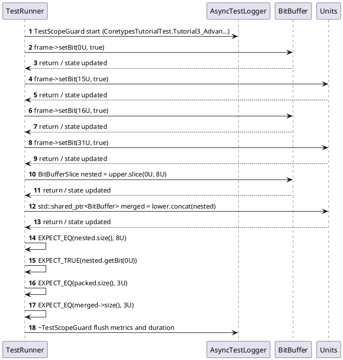

# Test Case: `CoretypesTutorialTest.Tutorial3_AdvancedBitBufferSlicingAndTemperatureOffset`

| Property | Value |
| :--- | :--- |
| **Module** | `coretypes` |
| **Source File** | `cmake-projects/coretypes/test_cs0100/TestCoretypesExtended.cpp` (lines 178–203) |
| **Category** | Pedagogical Tutorial (`CS-0100.19`) |
| **Traceability** | `[TSK-20260308-001]`, `[FE-0030]`, `[FE-0110]`, `[CS-0040.2]` |
| **Async Telemetry** | Enabled (`TestScopeGuard` + `AsyncTestLogger`) |

## Summary

Extended CS-0100 test suite for `quasar_coretypes` (tutorials, 20+ templates, temporal/unit boundaries, fuzz & stress).

## Sequence Diagram

## Observed Operations

- `frame->setBit(0U, true)`
- `frame->setBit(15U, true)`
- `frame->setBit(16U, true)`
- `frame->setBit(31U, true)`
- `BitBufferSlice nested = upper.slice(0U, 8U)`
- `std::shared_ptr<BitBuffer> merged = lower.concat(nested)`
- `std::vector<uint8_t> packed = merged->toVector()`
- `Quantity boilingC(100.0, Units::Celsius)`

## Verification Assertions

- `EXPECT_EQ(nested.size(), 8U)`
- `EXPECT_TRUE(nested.getBit(0U))`
- `EXPECT_EQ(packed.size(), 3U)`
- `EXPECT_EQ(merged->size(), 3U)`
- `EXPECT_NEAR(boilingK.value(), 373.15, 1e-6)`

---

[Back to `coretypes` Tests Overview](../coretypes.md)
