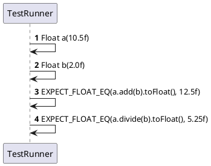

# Test Case: `FloatingPointTest.Arithmetic`

| Property | Value |
| :--- | :--- |
| **Module** | `coretypes` |
| **Source File** | `cmake-projects/coretypes/test/TestFloatingPoint.cpp` (lines 9–23) |
| **Category** | Unit & Regression Verification |
| **Traceability** | See module specification (`FE-*` / `TSK-*`) |
| **Async Telemetry** | Standard GTest / CTest stdout |

## Summary

Executes verification scenario `FloatingPointTest.Arithmetic` defined in `cmake-projects/coretypes/test/TestFloatingPoint.cpp`.

## Sequence Diagram

## Observed Operations

- `Float a(10.5f)`
- `Float b(2.0f)`

## Verification Assertions

- `EXPECT_FLOAT_EQ(a.add(b).toFloat(), 12.5f)`
- `EXPECT_FLOAT_EQ(a.divide(b).toFloat(), 5.25f)`

---

[Back to `coretypes` Tests Overview](../coretypes.md)
