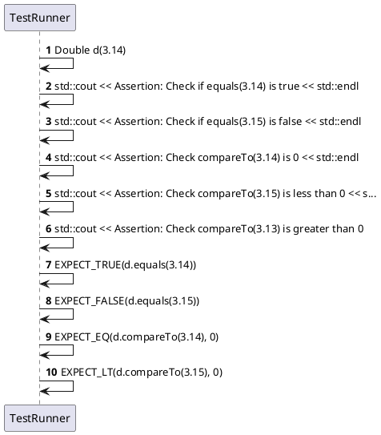

# Test Case: `FloatingPointTest.PrimitiveComparison`

| Property | Value |
| :--- | :--- |
| **Module** | `coretypes` |
| **Source File** | `cmake-projects/coretypes/test/TestFloatingPoint.cpp` (lines 89–139) |
| **Category** | Unit & Regression Verification |
| **Traceability** | See module specification (`FE-*` / `TSK-*`) |
| **Async Telemetry** | Standard GTest / CTest stdout |

## Summary

Executes verification scenario `FloatingPointTest.PrimitiveComparison` defined in `cmake-projects/coretypes/test/TestFloatingPoint.cpp`.

## Sequence Diagram

## Observed Operations

- `Double d(3.14)`
- `std::cout << "Assertion: Check if equals(3.14) is true" << std::endl`
- `std::cout << "Assertion: Check if equals(3.15) is false" << std::endl`
- `std::cout << "Assertion: Check compareTo(3.14) is 0" << std::endl`
- `std::cout << "Assertion: Check compareTo(3.15) is less than 0" << std::endl`
- `std::cout << "Assertion: Check compareTo(3.13) is greater than 0"`

## Verification Assertions

- `EXPECT_TRUE(d.equals(3.14))`
- `EXPECT_FALSE(d.equals(3.15))`
- `EXPECT_EQ(d.compareTo(3.14), 0)`
- `EXPECT_LT(d.compareTo(3.15), 0)`
- `EXPECT_GT(d.compareTo(3.13), 0)`
- `EXPECT_TRUE(d == 3.14)`
- `EXPECT_TRUE(d != 3.15)`
- `EXPECT_TRUE(d < 3.15)`
- `EXPECT_TRUE(d > 3.13)`
- `EXPECT_TRUE(nan.equals(std::numeric_limits<double>::quiet_NaN()))`

---

[Back to `coretypes` Tests Overview](../coretypes.md)
