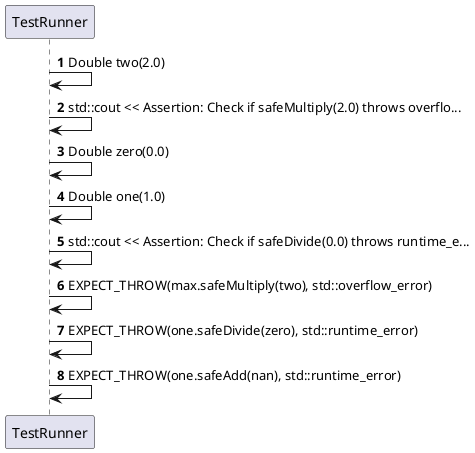

# Test Case: `FloatingPointTest.SafeArithmetic`

| Property | Value |
| :--- | :--- |
| **Module** | `coretypes` |
| **Source File** | `cmake-projects/coretypes/test/TestFloatingPoint.cpp` (lines 25–58) |
| **Category** | Unit & Regression Verification |
| **Traceability** | See module specification (`FE-*` / `TSK-*`) |
| **Async Telemetry** | Standard GTest / CTest stdout |

## Summary

Executes verification scenario `FloatingPointTest.SafeArithmetic` defined in `cmake-projects/coretypes/test/TestFloatingPoint.cpp`.

## Sequence Diagram

## Observed Operations

- `Double two(2.0)`
- `std::cout << "Assertion: Check if safeMultiply(2.0) throws overflow_error"`
- `Double zero(0.0)`
- `Double one(1.0)`
- `std::cout << "Assertion: Check if safeDivide(0.0) throws runtime_error"`

## Verification Assertions

- `EXPECT_THROW(max.safeMultiply(two), std::overflow_error)`
- `EXPECT_THROW(one.safeDivide(zero), std::runtime_error)`
- `EXPECT_THROW(one.safeAdd(nan), std::runtime_error)`

---

[Back to `coretypes` Tests Overview](../coretypes.md)
