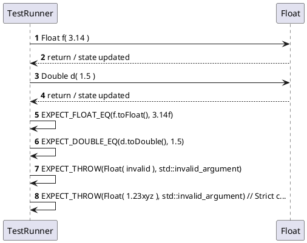

# Test Case: `FloatingPointTest.StringParsing`

| Property | Value |
| :--- | :--- |
| **Module** | `coretypes` |
| **Source File** | `cmake-projects/coretypes/test/TestFloatingPoint.cpp` (lines 60–87) |
| **Category** | Unit & Regression Verification |
| **Traceability** | See module specification (`FE-*` / `TSK-*`) |
| **Async Telemetry** | Standard GTest / CTest stdout |

## Summary

Executes verification scenario `FloatingPointTest.StringParsing` defined in `cmake-projects/coretypes/test/TestFloatingPoint.cpp`.

## Sequence Diagram

## Observed Operations

- `Float f("3.14")`
- `Double d("1.5")`

## Verification Assertions

- `EXPECT_FLOAT_EQ(f.toFloat(), 3.14f)`
- `EXPECT_DOUBLE_EQ(d.toDouble(), 1.5)`
- `EXPECT_THROW(Float("invalid"), std::invalid_argument)`
- `EXPECT_THROW(Float("1.23xyz"), std::invalid_argument); // Strict check`

---

[Back to `coretypes` Tests Overview](../coretypes.md)
