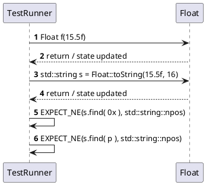

# Test Case: `FloatingPointTest.ToStringHex`

| Property | Value |
| :--- | :--- |
| **Module** | `coretypes` |
| **Source File** | `cmake-projects/coretypes/test/TestFloatingPoint.cpp` (lines 141–158) |
| **Category** | Unit & Regression Verification |
| **Traceability** | See module specification (`FE-*` / `TSK-*`) |
| **Async Telemetry** | Standard GTest / CTest stdout |

## Summary

Executes verification scenario `FloatingPointTest.ToStringHex` defined in `cmake-projects/coretypes/test/TestFloatingPoint.cpp`.

## Sequence Diagram

## Observed Operations

- `Float f(15.5f)`
- `std::string s = Float::toString(15.5f, 16)`

## Verification Assertions

- `EXPECT_NE(s.find("0x"), std::string::npos)`
- `EXPECT_NE(s.find("p"), std::string::npos)`

---

[Back to `coretypes` Tests Overview](../coretypes.md)
