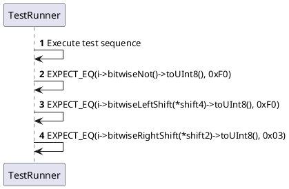

# Test Case: `IntegerPolymorphicTest.BitwiseNotAndShifts`

| Property | Value |
| :--- | :--- |
| **Module** | `coretypes` |
| **Source File** | `cmake-projects/coretypes/test/TestIntegerPolymorphic.cpp` (lines 217–224) |
| **Category** | Unit & Regression Verification |
| **Traceability** | See module specification (`FE-*` / `TSK-*`) |
| **Async Telemetry** | Standard GTest / CTest stdout |

## Summary

Executes verification scenario `IntegerPolymorphicTest.BitwiseNotAndShifts` defined in `cmake-projects/coretypes/test/TestIntegerPolymorphic.cpp`.

## Sequence Diagram

## Observed Operations

- Invokes standalone executable entry flow.

## Verification Assertions

- `EXPECT_EQ(i->bitwiseNot()->toUInt8(), 0xF0)`
- `EXPECT_EQ(i->bitwiseLeftShift(*shift4)->toUInt8(), 0xF0)`
- `EXPECT_EQ(i->bitwiseRightShift(*shift2)->toUInt8(), 0x03)`

---

[Back to `coretypes` Tests Overview](../coretypes.md)
