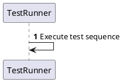

# Test Case: `IntegerPolymorphicTest.MatrixTests`

| Property | Value |
| :--- | :--- |
| **Module** | `coretypes` |
| **Source File** | `cmake-projects/coretypes/test/TestIntegerPolymorphic.cpp` (lines 190–192) |
| **Category** | Unit & Regression Verification |
| **Traceability** | See module specification (`FE-*` / `TSK-*`) |
| **Async Telemetry** | Standard GTest / CTest stdout |

## Summary

Executes verification scenario `IntegerPolymorphicTest.MatrixTests` defined in `cmake-projects/coretypes/test/TestIntegerPolymorphic.cpp`.

## Sequence Diagram

## Observed Operations

- Invokes standalone executable entry flow.

## Verification Assertions

- Verified via exit status `0` and runtime checks inside executable.

---

[Back to `coretypes` Tests Overview](../coretypes.md)
