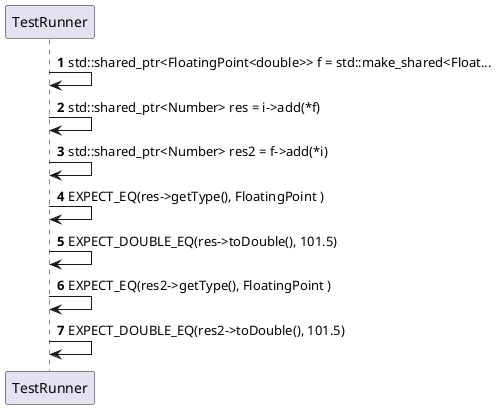

# Test Case: `IntegerPolymorphicTest.MixedWithFloatingPoint`

| Property | Value |
| :--- | :--- |
| **Module** | `coretypes` |
| **Source File** | `cmake-projects/coretypes/test/TestIntegerPolymorphic.cpp` (lines 194–205) |
| **Category** | Unit & Regression Verification |
| **Traceability** | See module specification (`FE-*` / `TSK-*`) |
| **Async Telemetry** | Standard GTest / CTest stdout |

## Summary

Executes verification scenario `IntegerPolymorphicTest.MixedWithFloatingPoint` defined in `cmake-projects/coretypes/test/TestIntegerPolymorphic.cpp`.

## Sequence Diagram

## Observed Operations

- `std::shared_ptr<FloatingPoint<double>> f = std::make_shared<FloatingPoint<double>>(1.5)`
- `std::shared_ptr<Number> res = i->add(*f)`
- `std::shared_ptr<Number> res2 = f->add(*i)`

## Verification Assertions

- `EXPECT_EQ(res->getType(), "FloatingPoint")`
- `EXPECT_DOUBLE_EQ(res->toDouble(), 101.5)`
- `EXPECT_EQ(res2->getType(), "FloatingPoint")`
- `EXPECT_DOUBLE_EQ(res2->toDouble(), 101.5)`

---

[Back to `coretypes` Tests Overview](../coretypes.md)
