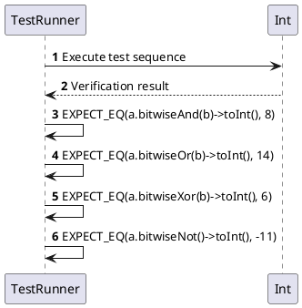

# Test Case: `IntegerTest.BitwiseOperations`

| Property | Value |
| :--- | :--- |
| **Module** | `coretypes` |
| **Source File** | `cmake-projects/coretypes/test/TestInteger.cpp` (lines 249–279) |
| **Category** | Unit & Regression Verification |
| **Traceability** | See module specification (`FE-*` / `TSK-*`) |
| **Async Telemetry** | Standard GTest / CTest stdout |

## Summary

Executes verification scenario `IntegerTest.BitwiseOperations` defined in `cmake-projects/coretypes/test/TestInteger.cpp`.

## Sequence Diagram

## Observed Operations

- Invokes standalone executable entry flow.

## Verification Assertions

- `EXPECT_EQ(a.bitwiseAnd(b)->toInt(), 8)`
- `EXPECT_EQ(a.bitwiseOr(b)->toInt(), 14)`
- `EXPECT_EQ(a.bitwiseXor(b)->toInt(), 6)`
- `EXPECT_EQ(a.bitwiseNot()->toInt(), -11)`
- `EXPECT_EQ(a.bitwiseLeftShift(Int(1))->toInt(), 20)`
- `EXPECT_EQ(a.bitwiseRightShift(Int(1))->toInt(), 5)`

---

[Back to `coretypes` Tests Overview](../coretypes.md)
