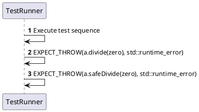

# Test Case: `IntegerTest.DivisionByZero`

| Property | Value |
| :--- | :--- |
| **Module** | `coretypes` |
| **Source File** | `cmake-projects/coretypes/test/TestInteger.cpp` (lines 63–79) |
| **Category** | Unit & Regression Verification |
| **Traceability** | See module specification (`FE-*` / `TSK-*`) |
| **Async Telemetry** | Standard GTest / CTest stdout |

## Summary

Executes verification scenario `IntegerTest.DivisionByZero` defined in `cmake-projects/coretypes/test/TestInteger.cpp`.

## Sequence Diagram

## Observed Operations

- Invokes standalone executable entry flow.

## Verification Assertions

- `EXPECT_THROW(a.divide(zero), std::runtime_error)`
- `EXPECT_THROW(a.safeDivide(zero), std::runtime_error)`

---

[Back to `coretypes` Tests Overview](../coretypes.md)
