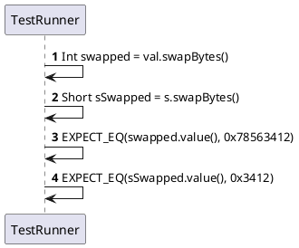

# Test Case: `IntegerTest.Endianness`

| Property | Value |
| :--- | :--- |
| **Module** | `coretypes` |
| **Source File** | `cmake-projects/coretypes/test/TestInteger.cpp` (lines 177–197) |
| **Category** | Unit & Regression Verification |
| **Traceability** | See module specification (`FE-*` / `TSK-*`) |
| **Async Telemetry** | Standard GTest / CTest stdout |

## Summary

Executes verification scenario `IntegerTest.Endianness` defined in `cmake-projects/coretypes/test/TestInteger.cpp`.

## Sequence Diagram

## Observed Operations

- `Int swapped = val.swapBytes()`
- `Short sSwapped = s.swapBytes()`

## Verification Assertions

- `EXPECT_EQ(swapped.value(), 0x78563412)`
- `EXPECT_EQ(sSwapped.value(), 0x3412)`

---

[Back to `coretypes` Tests Overview](../coretypes.md)
