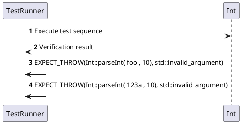

# Test Case: `IntegerTest.ParseIntExceptions`

| Property | Value |
| :--- | :--- |
| **Module** | `coretypes` |
| **Source File** | `cmake-projects/coretypes/test/TestInteger.cpp` (lines 101–112) |
| **Category** | Coverage, Enum, Boundary & Exception Containment (`CS-0100.1`, `CS-0100.3`, `CS-0100.4`, `CS-0100.6`, `CS-0100.9`) |
| **Traceability** | See module specification (`FE-*` / `TSK-*`) |
| **Async Telemetry** | Standard GTest / CTest stdout |

## Summary

Executes verification scenario `IntegerTest.ParseIntExceptions` defined in `cmake-projects/coretypes/test/TestInteger.cpp`.

## Sequence Diagram

## Observed Operations

- Invokes standalone executable entry flow.

## Verification Assertions

- `EXPECT_THROW(Int::parseInt("foo", 10), std::invalid_argument)`
- `EXPECT_THROW(Int::parseInt("123a", 10), std::invalid_argument)`

---

[Back to `coretypes` Tests Overview](../coretypes.md)
