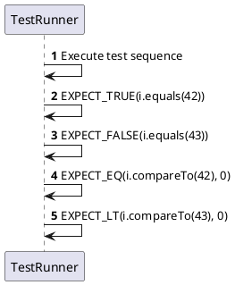

# Test Case: `IntegerTest.PrimitiveComparison`

| Property | Value |
| :--- | :--- |
| **Module** | `coretypes` |
| **Source File** | `cmake-projects/coretypes/test/TestInteger.cpp` (lines 316–365) |
| **Category** | Unit & Regression Verification |
| **Traceability** | See module specification (`FE-*` / `TSK-*`) |
| **Async Telemetry** | Standard GTest / CTest stdout |

## Summary

Executes verification scenario `IntegerTest.PrimitiveComparison` defined in `cmake-projects/coretypes/test/TestInteger.cpp`.

## Sequence Diagram

## Observed Operations

- Invokes standalone executable entry flow.

## Verification Assertions

- `EXPECT_TRUE(i.equals(42))`
- `EXPECT_FALSE(i.equals(43))`
- `EXPECT_EQ(i.compareTo(42), 0)`
- `EXPECT_LT(i.compareTo(43), 0)`
- `EXPECT_GT(i.compareTo(41), 0)`
- `EXPECT_TRUE(i == 42)`
- `EXPECT_TRUE(i != 43)`
- `EXPECT_TRUE(i < 43)`
- `EXPECT_TRUE(i > 41)`
- `EXPECT_TRUE(i <= 42)`

---

[Back to `coretypes` Tests Overview](../coretypes.md)
