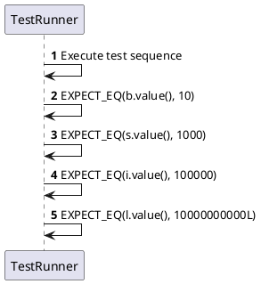

# Test Case: `IntegerTest.PrimitiveInitialization`

| Property | Value |
| :--- | :--- |
| **Module** | `coretypes` |
| **Source File** | `cmake-projects/coretypes/test/TestInteger.cpp` (lines 199–247) |
| **Category** | Unit & Regression Verification |
| **Traceability** | See module specification (`FE-*` / `TSK-*`) |
| **Async Telemetry** | Standard GTest / CTest stdout |

## Summary

Executes verification scenario `IntegerTest.PrimitiveInitialization` defined in `cmake-projects/coretypes/test/TestInteger.cpp`.

## Sequence Diagram

## Observed Operations

- Invokes standalone executable entry flow.

## Verification Assertions

- `EXPECT_EQ(b.value(), 10)`
- `EXPECT_EQ(s.value(), 1000)`
- `EXPECT_EQ(i.value(), 100000)`
- `EXPECT_EQ(l.value(), 10000000000L)`
- `EXPECT_EQ(ub.value(), 200)`
- `EXPECT_EQ(us.value(), 50000)`
- `EXPECT_EQ(ui.value(), 3000000000U)`
- `EXPECT_EQ(ul.value(), 10000000000000000000ULL)`

---

[Back to `coretypes` Tests Overview](../coretypes.md)
