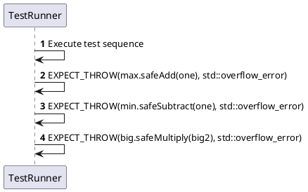

# Test Case: `IntegerTest.SafeArithmeticOverflow`

| Property | Value |
| :--- | :--- |
| **Module** | `coretypes` |
| **Source File** | `cmake-projects/coretypes/test/TestInteger.cpp` (lines 32–61) |
| **Category** | Unit & Regression Verification |
| **Traceability** | See module specification (`FE-*` / `TSK-*`) |
| **Async Telemetry** | Standard GTest / CTest stdout |

## Summary

Executes verification scenario `IntegerTest.SafeArithmeticOverflow` defined in `cmake-projects/coretypes/test/TestInteger.cpp`.

## Sequence Diagram

## Observed Operations

- Invokes standalone executable entry flow.

## Verification Assertions

- `EXPECT_THROW(max.safeAdd(one), std::overflow_error)`
- `EXPECT_THROW(min.safeSubtract(one), std::overflow_error)`
- `EXPECT_THROW(big.safeMultiply(big2), std::overflow_error)`

---

[Back to `coretypes` Tests Overview](../coretypes.md)
