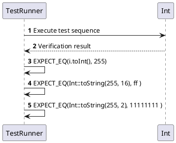

# Test Case: `IntegerTest.StringRadix`

| Property | Value |
| :--- | :--- |
| **Module** | `coretypes` |
| **Source File** | `cmake-projects/coretypes/test/TestInteger.cpp` (lines 81–99) |
| **Category** | Unit & Regression Verification |
| **Traceability** | See module specification (`FE-*` / `TSK-*`) |
| **Async Telemetry** | Standard GTest / CTest stdout |

## Summary

Executes verification scenario `IntegerTest.StringRadix` defined in `cmake-projects/coretypes/test/TestInteger.cpp`.

## Sequence Diagram

## Observed Operations

- Invokes standalone executable entry flow.

## Verification Assertions

- `EXPECT_EQ(i.toInt(), 255)`
- `EXPECT_EQ(Int::toString(255, 16), "ff")`
- `EXPECT_EQ(Int::toString(255, 2), "11111111")`

---

[Back to `coretypes` Tests Overview](../coretypes.md)
