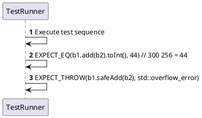

# Test Case: `IntegerTest.UByteType`

| Property | Value |
| :--- | :--- |
| **Module** | `coretypes` |
| **Source File** | `cmake-projects/coretypes/test/TestInteger.cpp` (lines 160–175) |
| **Category** | Unit & Regression Verification |
| **Traceability** | See module specification (`FE-*` / `TSK-*`) |
| **Async Telemetry** | Standard GTest / CTest stdout |

## Summary

Executes verification scenario `IntegerTest.UByteType` defined in `cmake-projects/coretypes/test/TestInteger.cpp`.

## Sequence Diagram

## Observed Operations

- Invokes standalone executable entry flow.

## Verification Assertions

- `EXPECT_EQ(b1.add(b2).toInt(), 44); // 300 % 256 = 44`
- `EXPECT_THROW(b1.safeAdd(b2), std::overflow_error)`

---

[Back to `coretypes` Tests Overview](../coretypes.md)
