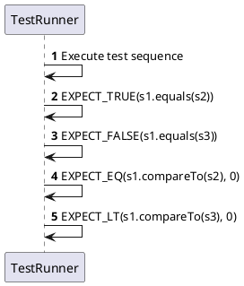

# Test Case: `StringTest.Comparison`

| Property | Value |
| :--- | :--- |
| **Module** | `coretypes` |
| **Source File** | `cmake-projects/coretypes/test/TestString.cpp` (lines 43–71) |
| **Category** | Unit & Regression Verification |
| **Traceability** | See module specification (`FE-*` / `TSK-*`) |
| **Async Telemetry** | Standard GTest / CTest stdout |

## Summary

Executes verification scenario `StringTest.Comparison` defined in `cmake-projects/coretypes/test/TestString.cpp`.

## Sequence Diagram

## Observed Operations

- Invokes standalone executable entry flow.

## Verification Assertions

- `EXPECT_TRUE(s1.equals(s2))`
- `EXPECT_FALSE(s1.equals(s3))`
- `EXPECT_EQ(s1.compareTo(s2), 0)`
- `EXPECT_LT(s1.compareTo(s3), 0)`
- `EXPECT_GT(s3.compareTo(s1), 0)`

---

[Back to `coretypes` Tests Overview](../coretypes.md)
