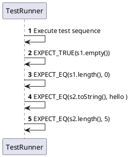

# Test Case: `StringTest.Creation`

| Property | Value |
| :--- | :--- |
| **Module** | `coretypes` |
| **Source File** | `cmake-projects/coretypes/test/TestString.cpp` (lines 7–41) |
| **Category** | Unit & Regression Verification |
| **Traceability** | See module specification (`FE-*` / `TSK-*`) |
| **Async Telemetry** | Standard GTest / CTest stdout |

## Summary

Executes verification scenario `StringTest.Creation` defined in `cmake-projects/coretypes/test/TestString.cpp`.

## Sequence Diagram

## Observed Operations

- Invokes standalone executable entry flow.

## Verification Assertions

- `EXPECT_TRUE(s1.empty())`
- `EXPECT_EQ(s1.length(), 0)`
- `EXPECT_EQ(s2.toString(), "hello")`
- `EXPECT_EQ(s2.length(), 5)`
- `EXPECT_EQ(s3.toString(), "world")`

---

[Back to `coretypes` Tests Overview](../coretypes.md)
