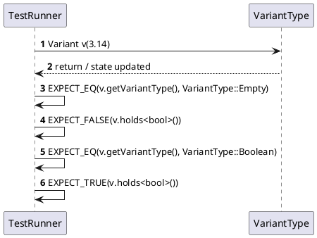

# Test Case: `VariantTest.BasicConstructionAndTypeChecking`

| Property | Value |
| :--- | :--- |
| **Module** | `coretypes` |
| **Source File** | `cmake-projects/coretypes/test/coretypes_variant_test.cpp` (lines 12–66) |
| **Category** | Unit & Regression Verification |
| **Traceability** | See module specification (`FE-*` / `TSK-*`) |
| **Async Telemetry** | Standard GTest / CTest stdout |

## Summary

Verifies that Variant can be constructed with all supported types and correctly reports its state.

## Sequence Diagram

## Observed Operations

- `Variant v(3.14)`

## Verification Assertions

- `EXPECT_EQ(v.getVariantType(), VariantType::Empty)`
- `EXPECT_FALSE(v.holds<bool>())`
- `EXPECT_EQ(v.getVariantType(), VariantType::Boolean)`
- `EXPECT_TRUE(v.holds<bool>())`
- `EXPECT_EQ(v.getAs<bool>(), true)`
- `EXPECT_EQ(v.toString(), "true")`
- `EXPECT_EQ(v.getVariantType(), VariantType::Integer)`
- `EXPECT_TRUE(v.holds<int64_t>())`
- `EXPECT_EQ(v.getAs<int64_t>(), 42)`
- `EXPECT_EQ(v.toString(), "42")`

---

[Back to `coretypes` Tests Overview](../coretypes.md)
